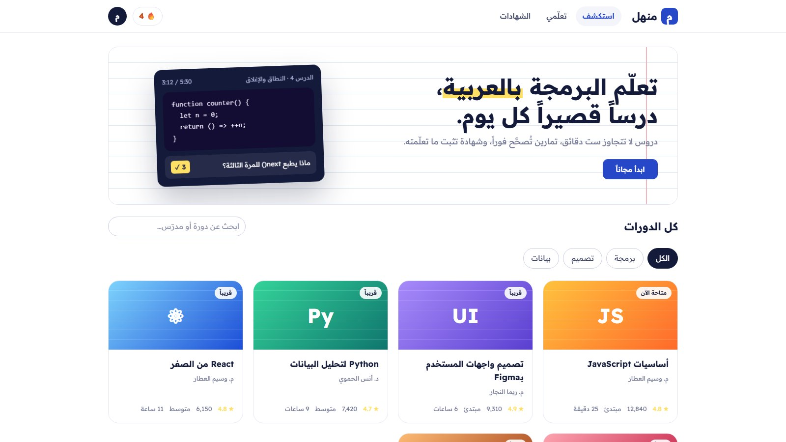

<div align="center">

# منهل · Manhal

**Arabic e-learning platform for programming courses**

[](https://abdulhadi.review/#demo/manhal) [](https://abdulhadi.review)

`React` · `TypeScript` · `Vite` · `CSS Modules` · `Figma`



</div>

---

<div dir="rtl" align="right">

## عن المشروع

**منصة تعليم إلكتروني** · 2024

منصة تعليمية للدورات التقنية بالعربية. كل درس فيديو قصير يليه تمرين عملي، ويتقدّم الطالب في مسار واضح ينتهي بمشروع تخرّج.

**المشكلة:** المحتوى التقني العربي متفرق على مقاطع طويلة بلا ترتيب ولا تمارين، فيبدأ المتعلم دورات كثيرة ولا ينهي أياً منها.

**الحل:** تقسيم كل دورة إلى وحدات ودروس لا تتجاوز عشر دقائق، مع تمرين بعد كل درس ومؤشر تقدّم ظاهر يشجع على الإكمال.

### أبرز المزايا

- مشغّل دروس يحفظ موضع التوقف
- تمارين برمجية تُصحَّح تلقائياً
- مسار تقدّم لكل وحدة ودورة
- نقاش تحت كل درس بين الطلاب والمدرّس
- شهادة إتمام قابلة للتحقق برابط

</div>

---

## Run locally

```bash
npm install
npm run dev        # http://localhost:5173
npm run build      # type-check and build to dist/
```

An interactive prototype from my portfolio. Demo data is generated in the browser and saved to localStorage only.


---

Designed and built by **Abdulhadi Almohammad** ([@abood352](https://github.com/abood352)) · [abdulhadi.review](https://abdulhadi.review)
